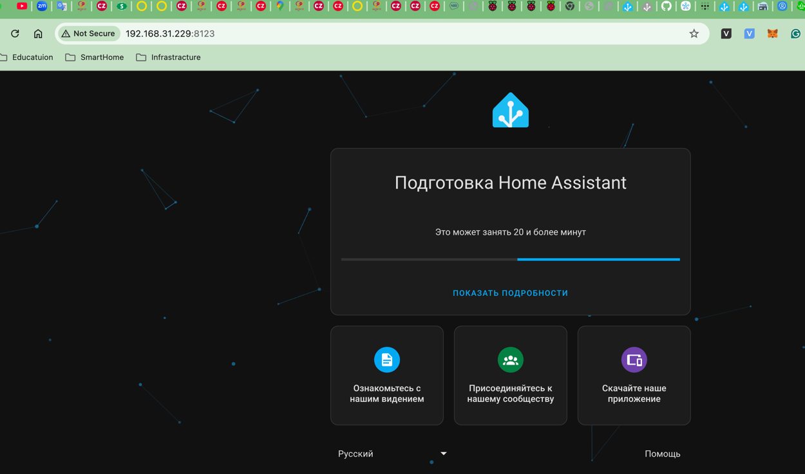

# homeassistant

# Requirements

1. Raspberry PI 4
2. Argon M2
3. SD card

# Init

1. Install on your laptop [Raspberry Pi Imager](https://www.raspberrypi.com/software/)
2. install Raspberry PI OS Lite 64 bit on sd card
3. Put SD card in raspberry
4. copy bootstrap script
    ```shell
     scp scripts/bootstrap.sh lev@raspberrypi.local:~/bootstrap.sh
    ```
5. connect via ssh to it and run the script
   ```shell
       ssh lev@raspberrypi.local -t 'sudo bash bootstrap.sh'
   ```
6. restart system
    ```shell
     ssh lev@raspberrypi.local -t  'sudo reboot'
    ```
7. copy init script
   ```shell
   scp scripts/init.sh lev@raspberrypi.local:~/init.sh
    ```
8. connect via ssh to it and run script
    ```shell
        ssh lev@raspberrypi.local -t 'sudo bash init.sh'
        ssh lev@raspberrypi.local -t 'sudo gpasswd -a $USER docker'
        ssh lev@raspberrypi.local  -t 'sudo newgrp docker'
    ```
9. Copy the Home Assistant Container installation script
     ```shell
      scp scripts/install-ha.sh lev@raspberrypi.local:
     ```
10. connect via ssh to it
    ```shell
        ssh lev@raspberrypi.local 'sudo bash install-ha.sh'
    ```
    This repository uses Home Assistant Container. It does not install Home Assistant
    OS, Supervisor, or add-ons; manage the installation through the Docker container.
11. If everything was ok then you will see:
    ```
    [info] Within a few minutes you will be able to reach Home Assistant at:
    [info] http://homeassistant.local:8123 or using the IP address of your
    [info] machine: http://192.168.31.229:8123
    ```
12. After a few minutes you can see


13. Install Tailscale
```shell
scp scripts/install-tailscale.sh lev@raspberrypi.local:
ssh lev@raspberrypi.local -t 'sudo bash install-tailscale.sh'
```

## Raspberry Pi monitoring

The [Raspberry Pi dashboard](homeassistant/README.md#raspberry-pi-monitoring)
shows CPU usage and temperature, memory, storage, system load, and boot time.
Its sensors and dashboard are managed in this repository.

## Maintenance

`bootstrap.sh` installs normal Raspberry Pi OS updates but skips `rpi-update` by
default. Use firmware updates only when needed for a known issue:

```shell
ssh lev@raspberrypi.local -t 'sudo RPI_UPDATE=1 bash bootstrap.sh'
```

The Argon, Docker, and Tailscale installation scripts are downloaded over HTTPS to a
temporary file before execution. For a fully reproducible build, use a reviewed,
checksum-verified installer URL through the corresponding `*_INSTALL_URL` variable.
